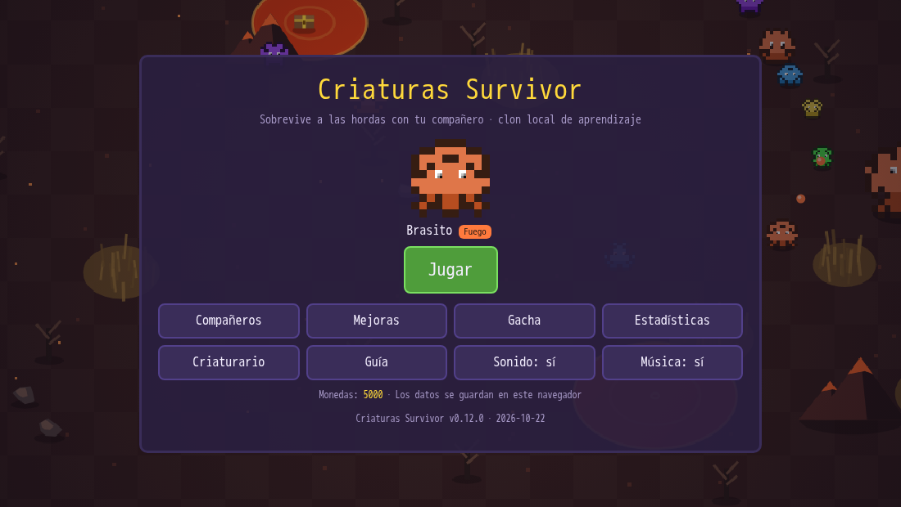
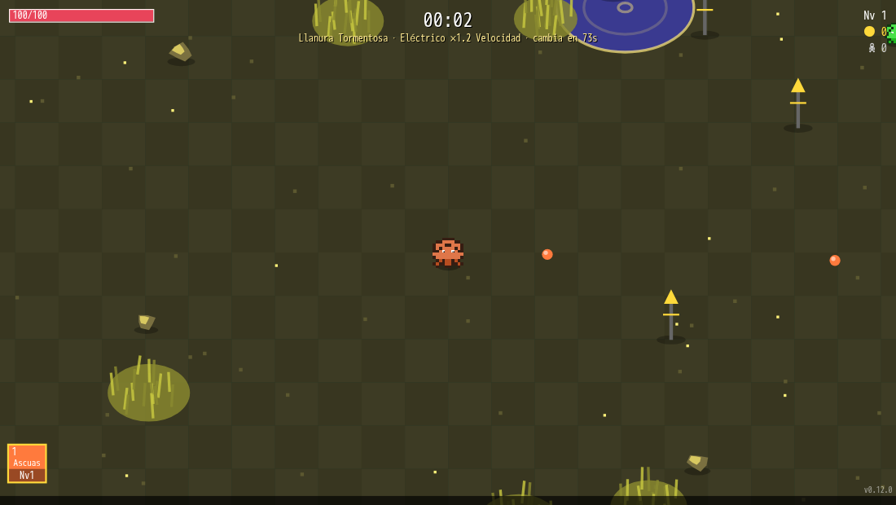
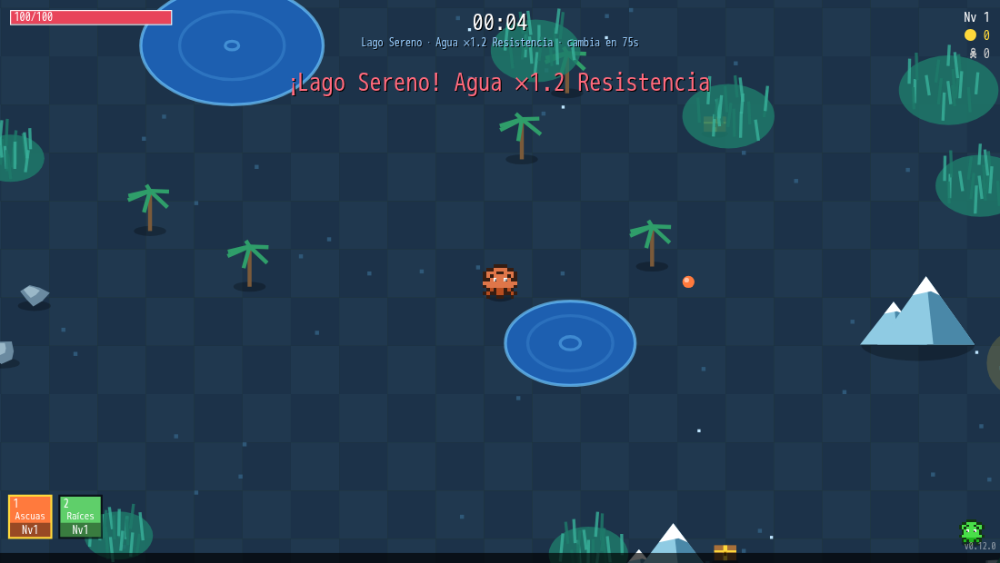
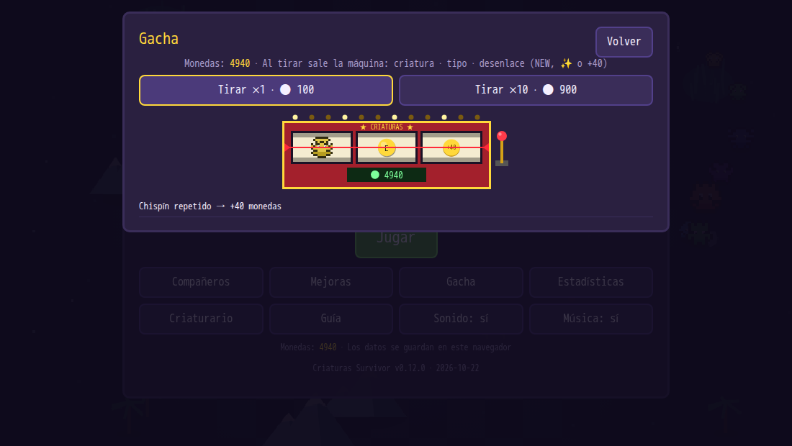
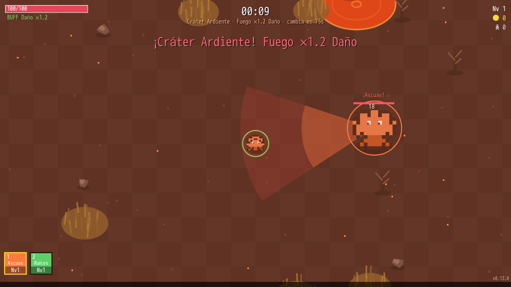
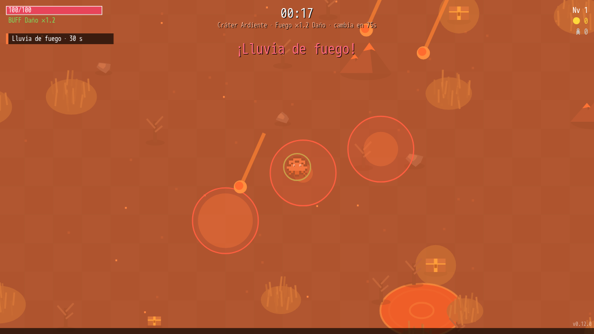
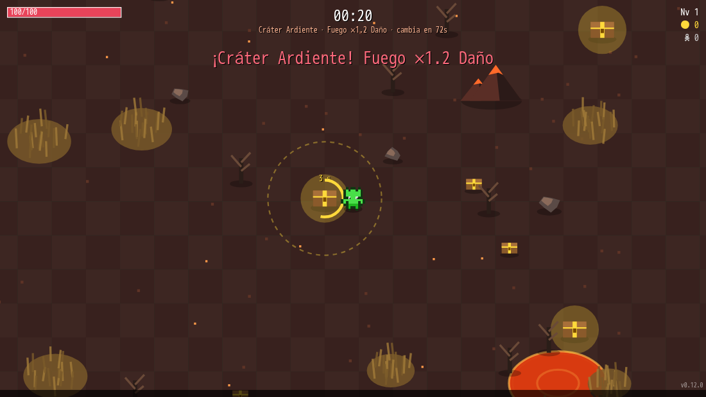
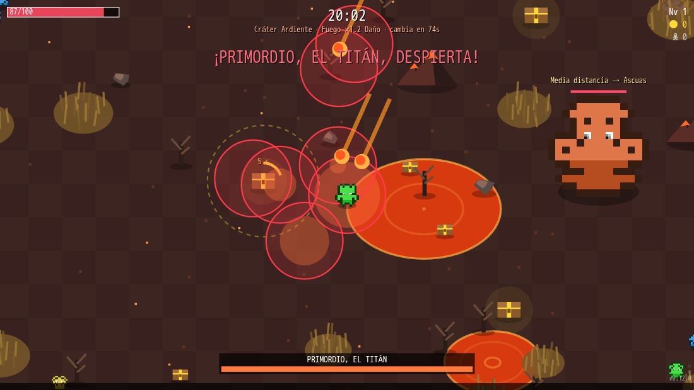
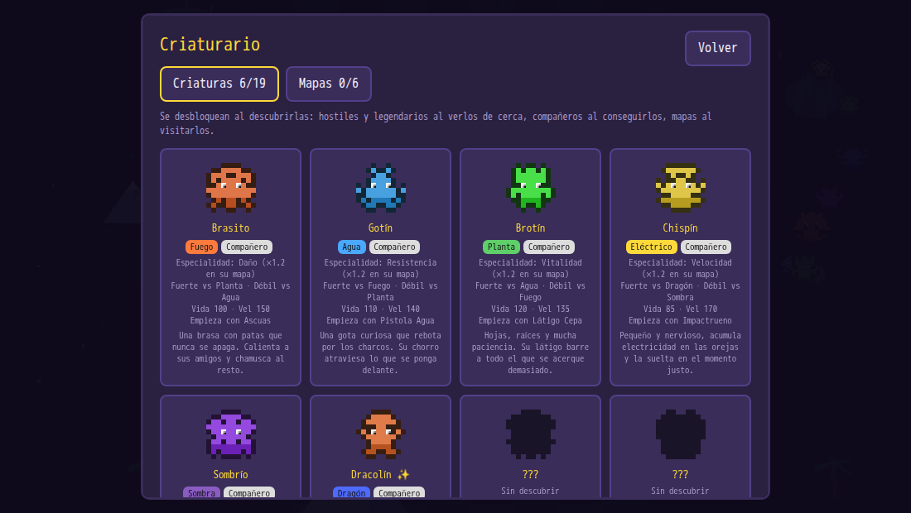

# Criaturas Survivor

**Versión actual: v0.14.0** (2026-10-23). La versión se ve en el menú, en la Guía y en la esquina inferior derecha durante la partida.

Juego de supervivencia tipo *Survivor* para el navegador: eliges un compañero, esquivas hordas, subes de nivel y mejoras tus ataques. Todo el juego es **un solo `index.html`** (canvas + JavaScript, sin dependencias ni servidor); la música de fondo son seis ficheros de audio opcionales. Se puede **llevar en una carpeta** y jugar con doble clic (ver [Versión portable](#versión-portable)). Proyecto de aprendizaje.

Las criaturas se dibujan por código a partir de una semilla; no hay imágenes ni nombres de terceros (ver [`rules/001-sin-assets-oficiales.md`](rules/001-sin-assets-oficiales.md)). **La música de fondo está generada con IA** (ver [Créditos](#créditos-y-licencias)).

## Capturas
| | | |
|---|---|---|
|  |  |  |
|  |  |  |
|  |  |  |

*(Se regeneran con `bash scripts/capturas.sh`.)*

## Cómo jugar
Tres formas, de la más sencilla a la más completa:
1. **Portable (doble clic):** descomprime el `.zip` de [Versión portable](#versión-portable) y abre `index.html` (o `Jugar.bat` en Windows, `jugar.sh` en Linux/macOS). No instala nada ni necesita conexión; la música también suena así (modo directo para `file://`).
2. **Desde el repositorio:** abre `index.html` con el navegador, o sírvelo con cualquier servidor estático (`python3 -m http.server`).
3. **Servido en el homelab:** ver [Publicación](#publicación-homelab).

| Acción | Control |
|---|---|
| Moverse | WASD / flechas / arrastrar el dedo |
| Atacar | Automático |
| Movimiento principal (+25% daño) | 1–4 · Q/E |
| Cambiar opciones al subir de nivel | R |
| Pausa | Esc |

## Qué incluye
| Sistema | Resumen | Dónde se ajusta |
|---|---|---|
| Compañeros | 6 criaturas (3 gratis, 3 por Gacha, versión shiny +10% de daño) | `SPECIES` |
| Movimientos | 15: 9 de ataque y 6 de control; al nivel 5 evolucionan; **Vínculo** une dos en un hueco | `MOVES`, `fire()` |
| Objetos | Uno por partida (niveles 5, 15, 25…) | `ITEMS` |
| Pasivas | 12 en 4 ramas (Agilidad, Fortaleza, Poder, Ingenio), hasta nivel 5 y 4 por partida; las ramas opuestas se excluyen (Agilidad ⟂ Fortaleza, Poder ⟂ Ingenio) | `BRANCHES`, `PASSIVES` |
| Mapas | 6 (uno por tipo), cambian cada 75 s; las criaturas del tipo del mapa, hostiles o tu compañero, ganan ×1.2 en su especialidad | `MAPS`, `MAP_BUFF`, `MAP_EVERY`, `TYPE_BUFF` |
| Ventajas por tipo | Dos triángulos (Fuego > Planta > Agua > Fuego y Eléctrico > Dragón > Sombra > Eléctrico): ×1.3 a favor y ×0.75 en contra, en ambos sentidos | `STRONG`, `EFF_UP`, `EFF_DOWN` |
| Control | Un movimiento por tipo con estado propio: ralentizar (agua), inmovilizar (planta), paralizar (eléctrico), quemar (fuego), reducir el alcance del enemigo (sombra) y tornado que junta (dragón); los legendarios resisten | `MOVES`, `status()` |
| Obstáculos | Montañas y árboles (sólidos, indestructibles), piedras (sólidas, se rompen), hierba alta (reduce la visión, se rompe; aguanta la mitad que una piedra) y líquidos (dañan o ralentizan salvo al tipo del mapa); cambian de aspecto y efecto con cada mapa | `BIOME`, `getChunk()` |
| Hostiles | 6 tipos que aparecen por tiempo. Los violetas (Sombra) tienen la mitad de alcance. Chispamurci, Magmaroca y Dracoaleta **embisten** con el recorrido marcado en el suelo (esquivable) | `ENEMY_TYPES`, `REACH`, `enemyDash()` |
| Jefes | Un legendario tipado cada 4 minutos que repite un **guion fijo de 5 ataques** de su tipo, con aviso en el suelo antes de cada uno y el siguiente visible sobre su cabeza; al 30% de vida se enfurece (+20% de daño). Sus ondas y zonas dejan estados en ti | `BOSS_SCRIPT`, `BOSS_ATK`, `bossStep()` |
| Megajefe | **Primordio, el Titán** a los 20 min (y cada 20): lento y enorme, con los ataques de los 6 tipos elegidos por tu distancia (cerca ondas y anillos; media abanicos, zonas y ráfagas; lejos embestidas, tornados y meteoros), descansa cada 3 ataques e invoca legendarios al 100/75/50/25% de vida. **Al despertar, los hostiles normales se desvanecen** y no aparecen más mientras viva: sólo quedan los legendarios. Todos los jefes son inmunes a paralizar, inmovilizar y ralentizar. **Es inmune a paralizar, inmovilizar y ralentizar (incluido el ciclón)** y **la primera vez que su vida llega a 0 no muere: se abre un portal, huye y vuelve a los 40 min con la vida completa (+50%)**; entre medias aparecen el doble de criaturas. Tiene 10× la vida de un legendario, regenera un poco y **se adapta a tu daño**: con poco daño se impacienta (velocidad, daño y ataque suben) y con muchísimo gana armadura | `MEGA`, `MEGA_MOVES`, `megaPick()`, `spawnMega()` |
| Aparición | Pocos hostiles al empezar y más con el tiempo (`spawnRate`, `spawnCap`) | `spawnRate()` |
| Eventos | Cada 45-75 s: marea de monstruos (spawn ×2,5), lluvia de agua (buffs y nerfeos por tipo) o lluvia de fuego (meteoritos con aviso en el suelo) | `EVENTS`, `RAIN_FX`, `METEOR`, `updateEvents()` |
| Cofres | Pequeños (se rompen a golpes: monedas, experiencia u objeto) y grandes (quédate cerca 6 s: botín grande y objeto garantizado) | `CHEST`, `openChest()` |
| Líquidos | El tipo del mapa es inmune; el contrario sufre ×1,5 y hace un 20% menos de daño; el resto, efecto normal | `liqEffect()` |
| Disparos | Los proyectiles, tuyos y enemigos, se paran contra montañas y árboles (no contra piedras) | `update()` |
| Música | Una pista chillout por tipo de mapa con fundido cruzado de 3 s y botón «Música» | `music/`, `playMusic()` |
| Menú | Fondo animado: un mapa de bioma que rota cada 16 s con criaturas por **rutas fijas** (sin IA ni colisiones), mapa pintado una vez, 30 fps máx., quieto con un panel abierto o con «menos movimiento» | `drawMenuBg()`, `RUTA`, `menuEscena()` |
| Criaturario | Enciclopedia de 19 criaturas (incluido el Titán) y 6 mapas que se desbloquean al descubrirlos | `DEX`, `DESC` |
| Progreso | Monedas → mejoras permanentes y Gacha; todo se guarda en `localStorage` | `UPGRADES`, `SAVE` |
| Gacha | Tragamonedas retro baja y ancha (320×108) que **sólo se despliega al tirar**, **sólo visual**: criatura · tipo · desenlace (NEW / ✨ / +40); la tirada ya está decidida al girar | `gachaRoll()`, `slotSpin()`, `slotDraw()` |

## Versión portable
Para llevar el juego en una memoria USB, un correo o a otro ordenador:
```
bash scripts/empaquetar.sh     # crea dist/ (fuera de Git) con dos carpetas y su .zip cada una
```
| Paquete | Contenido | Tamaño |
|---|---|---|
| `criaturas-survivor-v<versión>-portable` | `index.html` + `music/` (6 pistas) + `LEEME.txt` + `CREDITOS.txt` + `Jugar.bat` + `jugar.sh` + `jugar-con-servidor.sh` | ~16 MB |
| `criaturas-survivor-v<versión>-ligera` | lo mismo sin `music/` (sin música; se puede copiar la carpeta después) | ~160 KB |

- **Sin instalar nada:** basta un navegador actual (Chrome, Edge, Firefox, Safari). Si el navegador no reprodujera la música al abrir el fichero directamente, `jugar-con-servidor.sh` lo sirve en local con `python3`.
- **Música desde `file://`:** al abrir un fichero local el navegador silencia el audio que pasa por WebAudio (CORS; medido: señal 0 frente a 0,14 con servidor). Por eso el juego tiene un **modo directo** que se activa solo en `file://` y aplica los fundidos sobre el volumen del propio `<audio>`.
- **Tu partida no viaja con la carpeta** (vive en el navegador): usa *Menú › Estadísticas › Exportar partida* y, en el otro sitio, *Importar partida* (fichero `.json` validado y saneado).
- **Comprobación:** `bash scripts/probar-portable.sh dist/criaturas-survivor-v<versión>-portable` abre el paquete por `file://` en Chromium real y verifica que carga, que suena la música y que exportar/importar funcionan.

## Estructura del repositorio
```
index.html                 el juego completo (secciones comentadas, ver abajo)
music/                     6 pistas <tipo>.mp3 (fuera de Git; se regeneran con la IA local)
scripts/smoke.js           prueba en Node con DOM y audio falsos (12 min simulados + aserciones exactas)
scripts/audit-secrets.sh   auditoría de secretos antes de cada commit
scripts/sync-dashboard.sh  copia index.html y music/ al homelab: --test = versión de prueba; sin --test = demo y pública (simula; --apply)
scripts/empaquetar.sh        versión portable en dist/ (carpeta completa y ligera, con .zip)
scripts/probar-portable.sh abre un paquete portable por file:// en Chromium real y lo verifica (probar_portable.py)
scripts/publicar-github.sh crea el repo PRIVADO en GitHub y sube main (simula; --apply)
scripts/capturas.sh         capturas de pantalla con Chromium sin pantalla (Playwright en Docker; PNG en capturas/, fuera de Git)
scripts/generar_musica.sh  genera las 6 pistas con ACE-Step en el ComfyUI del PC (simula; --apply)
rules/                     reglas del proyecto (una por fichero)
docs/capturas/             capturas del README
.github/workflows/         integración continua: auditoría de secretos + prueba de humo
LICENSE                    todos los derechos reservados
CLAUDE.md / AGENTS.md      instrucciones para asistentes de código (AGENTS.md apunta a CLAUDE.md)
memory.md                  registro de tareas, la más reciente primero
CHANGELOG.md               historial por versión
```

### Secciones de `index.html`
1 datos · 2 guardado · 3 sprites procedurales · 4 audio (osciladores) · 4b música · 5 estado de la run · 6 lógica (incluye «Mundo», `update`, `fire`, subida de nivel, fin de run) · 7 dibujo · 8 menús · 9 bucle principal.

- **Equilibrar:** editar las tablas de la sección 1 y `xpNeed`.
- **Añadir un movimiento:** entrada en `MOVES` + `case` en `fire0()`.
- **Añadir una pasiva:** entrada en `PASSIVES` y su efecto en `mult()` o donde se use `pl('id')`.
- **Añadir un tipo de obstáculo:** clase en `getChunk()`, aspecto en `BIOME` y una función `draw…`.

## Probar
```
bash scripts/probar-portable.sh dist/criaturas-survivor-v<versión>-portable   # tras empaquetar: el paquete por file:// en Chromium real
bash scripts/capturas.sh       # capturas de pantalla (comprueba lo visual; 1.ª vez descarga ~3,5 GB de imagen Docker)
node scripts/smoke.js          # debe acabar en "SMOKE OK" (comprueba también que VERSION coincide con CHANGELOG.md y README.md)
bash scripts/audit-secrets.sh  # antes de cada commit; debe salir "limpio"
```

## Música (IA local)
Las pistas las genera ACE-Step v1 3.5B en el ComfyUI del PC, lanzado desde la torre:
```
export COMFY_HOST=<IP Tailscale o nombre del PC>   # no se guarda en el repo
bash scripts/generar_musica.sh                     # simula y muestra los prompts
bash scripts/generar_musica.sh --apply             # genera las 6 (~3 min); también: --apply fuego dragon
```
Necesita ComfyUI arrancado en el PC (`creacion-local`). Cada pista se anota en el catálogo de `musica-ia-lofi` (regla 001 de ese repo). Todas comparten tonalidad (La menor) y tempos de 65–85 bpm para que el fundido entre mapas no choque. Si falta un fichero, ese mapa va sin música.

## Publicación (homelab)
Hay tres entornos servidos por contenedores nginx de solo lectura en `dashboard-stack`: una **versión de prueba** (sin caché, accesible desde el panel de acceso), una **demo** tras el panel de acceso y una **versión pública** sin login. El flujo es probar primero (`scripts/sync-dashboard.sh --test --apply`) y, sólo cuando se aprueba, sincronizar la demo y la pública con `scripts/sync-dashboard.sh --apply` (ambas copian `index.html` y `music/`). El servidor debe permitir audio: el CSP lleva `media-src 'self'`. Detalles de despliegue en el repo `dashboard-stack`.

## GitHub
El repositorio es **público** (`yeagoblab/criaturas-survivor`) en modo «sólo lectura»: se puede ver el código y jugar, pero **no se puede reutilizar** (ver [`LICENSE`](LICENSE): todos los derechos reservados). Los commits usan el correo *noreply* de GitHub (no hay correos personales en el historial). El script que lo creó (primero como privado) hace antes la auditoría de secretos de todo el historial, comprueba que no haya cambios sin commit y verifica después la visibilidad:
```
bash scripts/publicar-github.sh            # simula: muestra qué haría
bash scripts/publicar-github.sh --apply    # crea el repo privado y sube
```
Cada subida ejecuta en GitHub Actions (`.github/workflows/smoke.yml`) la auditoría de secretos y la prueba de humo. Las pistas de `music/`, `dist/`, `capturas/` y los `.zip` **no se suben** (regla 002): la música se regenera con `scripts/generar_musica.sh`.

## Versionado
`0.x.0` por cada mejora (la 0.1.0 es la primera versión) y `0.x.y` para correcciones. Al subir de versión se cambian a la vez `VERSION` y `VERSION_DATE` en `index.html` y el primer encabezado de `CHANGELOG.md`; `smoke.js` falla si no coinciden (regla 003).

## Créditos y licencias
- Código, criaturas, sprites y datos: propios. No hay assets de Nintendo, Game Freak ni SpriteCollab; el juego que inspiró el género tiene sprites CC BY-NC y código PolyForm Noncommercial, de los que no se copió nada.
- **Música: generada con IA** con [ACE-Step v1 3.5B](https://github.com/ace-step/ACE-Step) (licencia Apache-2.0 verificada el 2026-10-21 en el repo oficial y en la ficha de los pesos), ejecutado en local. Se declara su origen artificial en la Guía del juego, como pide la ficha del modelo.

## Reglas del proyecto
Ver [`rules/README.md`](rules/README.md): 001 sin assets oficiales · 002 música de IA declarada y anotada · 003 versión coherente con el CHANGELOG.

## Estado y pendientes
Jugable y en mejora continua (v0.14.0). Pendiente: probar a mano el equilibrio (sobre todo el del Titán y la rapidez de la subida de nivel), subir el repo a GitHub y añadir un monitor de disponibilidad en el homelab. Ver `memory.md`.
